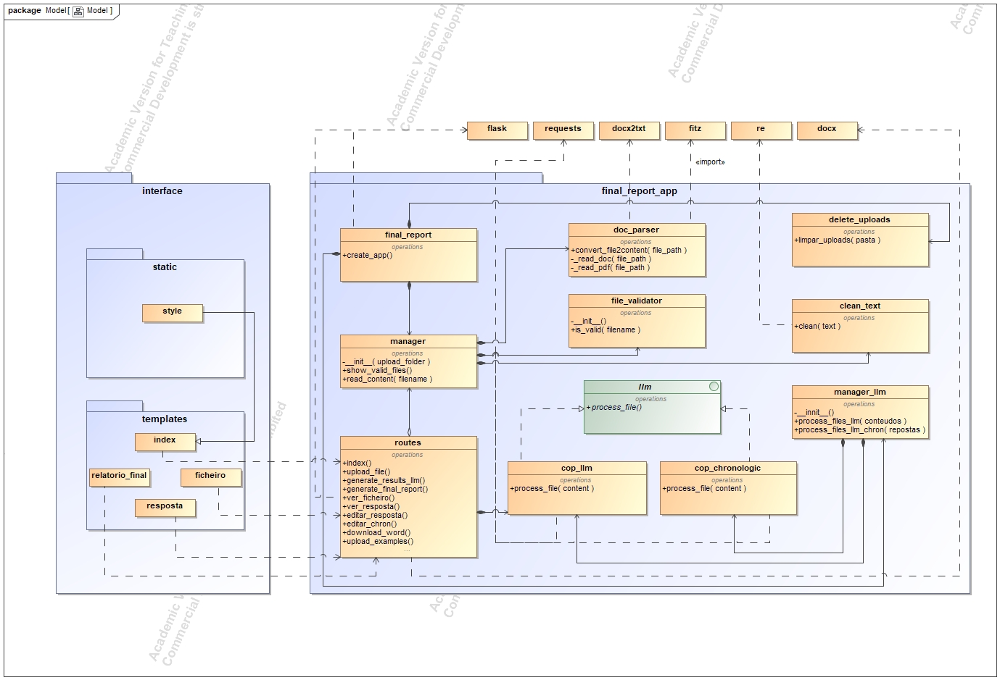

# Criminal Case Summary System

Automated system powered by Artificial Intelligence and **Large Language Models** (LLMs) to support criminal investigation and speed up the generation of final case reports.

Developed at **ISEL** in collaboration with the **Portuguese Criminal Investigation Police**, National Unit for Combating Cybercrime and Technological Crime.

## Overview

Reading and interpreting complex criminal case files by hand is slow and repetitive. This web application takes the documents of a case, summarizes each one with a specialized LLM agent and merges the results into a structured, chronological final report that can be reviewed, edited and exported to Word.

Everything runs locally through [Ollama](https://ollama.com/) with the Gemma 3 model, so case data is processed on the machine where the application runs.

## Features

- Upload and validation of PDF and DOCX case files
- One specialized agent per document type: Inquiry Cover, Case Note, Witness Statement Record, Attachment Record, Notice to the Injured Party and Open-Source Information Report
- Chronological summary agent that merges the individual summaries
- Final report with six fixed sections: Crime, Procedural Subjects, Facts, Modus Operandi, Investigation Steps and Conclusion
- Viewing and editing of each summary and of the final report in the browser
- Export of the final report to Word, in `.docx`.

## Architecture



The `final_report_app` package contains the application logic, them being the routes, file parsing and validation, LLM managers. The `interface` package contains the templates and static files. The agents are defined as Ollama Modelfiles in `03_Implementacao/models`.

## Tech stack

Python, Flask, Ollama, Gemma 3, PyMuPDF, python-docx, Docker.

## Getting started

**Prerequisite:** [Docker Desktop](https://www.docker.com/products/docker-desktop/)

```bash
cd 03_Implementacao
docker build -t criminal-case-summary .
docker run -p 5000:5000 criminal-case-summary
```

The first build downloads the `gemma3:4b` model and can take a while. When the container is running, open <http://localhost:5000>.

To run with Flask debug mode (local development only), add `-e FLASK_DEBUG=1` to the `docker run` command.

## Usage Steps

1. Upload the case documents. Only files containing PDF or DOCX extensions.
2. Generate the individual summaries.
3. Optionally upload example reports you want the model to follow to guide the output style.
4. Generate the final report, review and edit it.
5. Download the report as a Word document.

## Repository structure

```
00_Planning/         Project planning
01_Analysis/Spikes/  Early prototypes and experiments
02_Design/           Design (class diagram)
03_Implementation/   Source code, Modelfiles and Dockerfile
04_Report/           Full project report (in Portuguese)
```

## Notes

- The application prompts and sample documents are in Portuguese, since they target Portuguese legal documents.
- All sample cases shown on the portfolio page are fictitious. Never commit real case files to this repository.
- The output of an LLM can contain errors: the generated report is a support tool and must always be reviewed by a person.
